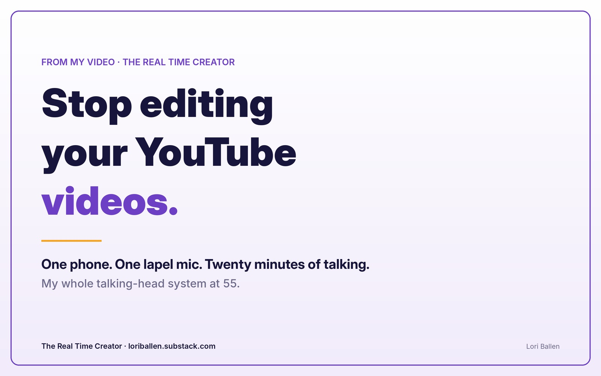
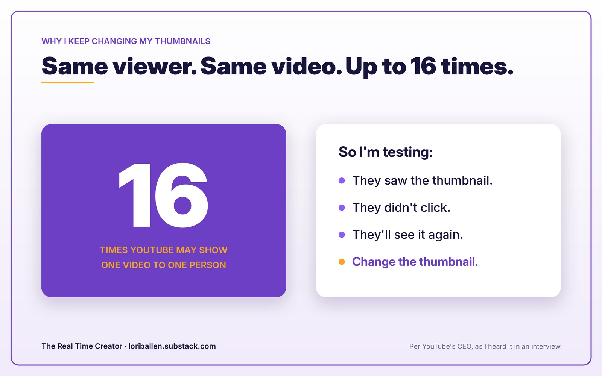
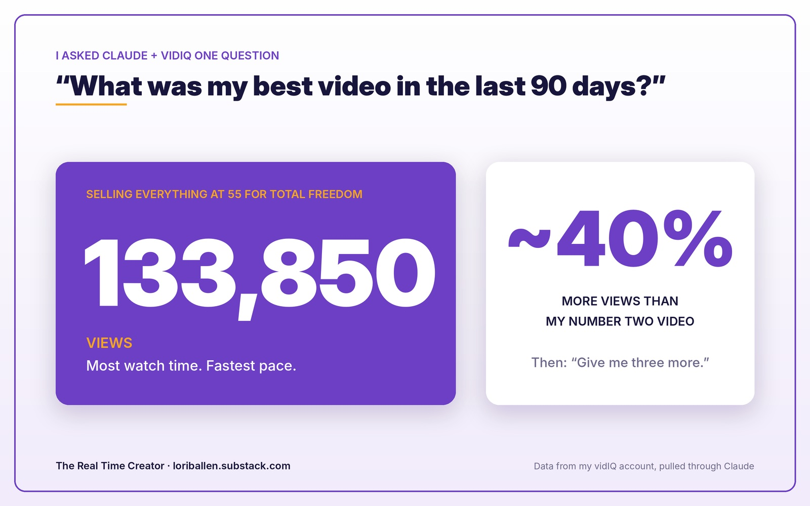
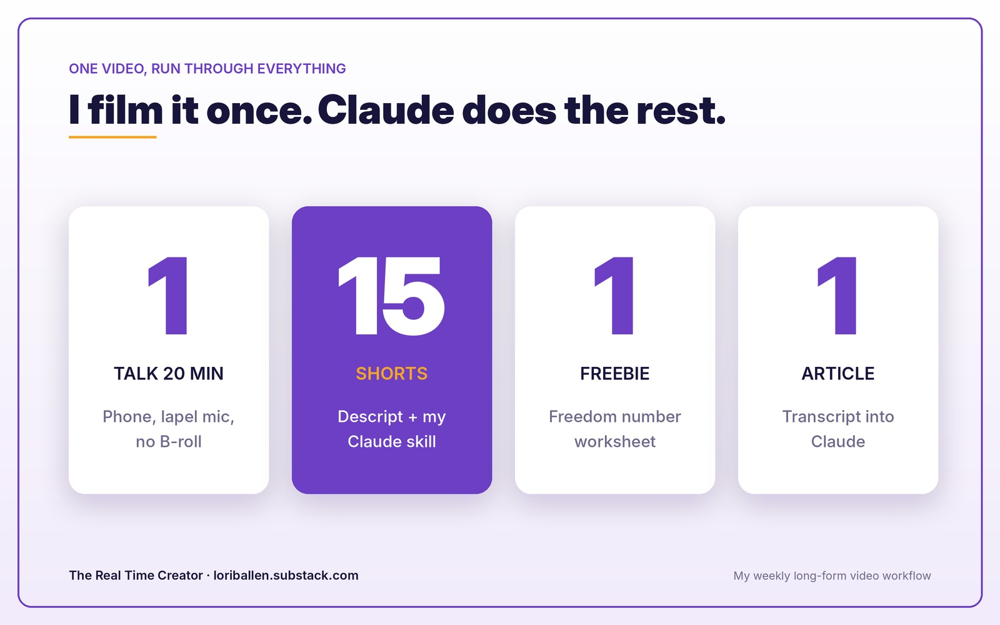

# Stop Editing Your YouTube Videos. My Whole Talking-Head System at 55.

*How I film on my phone, let vidIQ and Claude tell me what to make next, and turn one video into shorts, a worksheet, and this article.*

*Some links in this post are affiliate links. If you buy through them, I may earn a commission at no extra cost to you. I only share tools I actually use.*

[EMBED THE YOUTUBE VIDEO HERE]

I cannot tell you how many of my YouTube videos blow up when I don't edit them at all.

I just sit and talk. Talking head, like this. And YouTube loves them.

The comments say the same thing every time. *"You're so authentic. Thank God you're just real. Thank God this isn't over-chopped and over-clipped."*

Here's the part that surprised me. When I take one of my two-hour coaching calls and cut it into a 20-minute highlight video, it doesn't do anywhere near as well as when I just sit back down and talk for 20 minutes.

The editing does worse. That's my experience, on my channel.

Now, if you make murder mysteries or alien videos, you need the sound effects and the cuts. That's a different game. But if you can talk and tell a story?

**Don't edit.**

## My exact process (it fits in a paragraph)

Today's video, *Are You Too Old for YouTube*, I made on my phone right before my coaching call.

I sat in my chair. Light on. Phone in its spot. A little lapel mic plugs into the end of the phone and clips to my shirt. I talked for 20 minutes.

Then I upload it to CapCut. I'm not going to be one of those creators who tells you I don't filter. I filter. I click my preset and it softens things up so I can get on camera today. Some days I wear no makeup at all and CapCut has a makeup button for that.

I clip the front where you see me pushing the button. I clip the end where I go "blah." I export it and upload it to YouTube.

Then that same video goes into [Descript](https://loriballen.com/go/descript), and one button turns it into a stack of short-form videos.

**That's my exact process.**

## I hate B-roll, and I tested it

I actually ran the test. One video loaded with B-roll. One video, just me talking, no B-roll.

The unedited talking head won.

And honestly, I can't stand watching it. Someone says, "So I went to the bank," and the screen cuts to a stranger walking into a bank. I'm out. That generic clip-art B-roll drives me crazy.

So I stopped doing it.

## Why I keep changing my thumbnails

Have you ever lain in bed with the remote, scrolling YouTube thumbnails?

YouTube shows you different suggestions depending on the time of day and the device. At 6 a.m. mine is yoga, stretching, and workouts. At night it's genealogy, adoption stories, and near-death experiences. I never told it that. It learned.

But I kept seeing the same thumbnails over and over. Then I watched YouTube's CEO explain that they'll show the same video to the same person about **16 times** before taking it out of suggested.

So here's what I'm testing. If someone saw my thumbnail and didn't click, and they're going to see it 15 more times, what if I change the thumbnail?

[vidIQ](https://loriballen.com/go/vidiq) does this right inside my channel. Quick generate, create from a prompt, or my favorite, **start from any frame.**

That wave I do at the end of every video? "Bye," with my hand up and a big smile? You barely see it. I do it so I'm posed for my thumbnail. I pick that frame, and vidIQ builds a thumbnail from it.

Then I can tell it, "Make me prettier, fix my hair, put on lipstick." Each round uses a few credits.

## Then I ask Claude what to make next

This is where it gets fun. vidIQ is connected to Claude, so I don't even open the extension most days.

I opened my YouTube channel project in Claude and asked one question: *"What was my best video in the last 90 days?"*

It came back with real numbers. **Selling Everything at 55 for Total Freedom. 133,850 views, about 40% more than my number two video.** Most watch time, fastest pace.

That one answer started a whole chain. Next video ideas. How to monetize them. And a finished freebie my viewers can download.

You're like me. Most of you reading this already have a channel or want one, and the hard part isn't filming. It's knowing what to make, and what it's for.

Below is the exact conversation I run, prompt by prompt, plus how I get 15 shorts and a Substack article out of every single video without opening an editor.

## The Claude + vidIQ conversation, step by step

**1. Connect vidIQ once.** In Claude, add a connector. vidIQ gives you the URL, you paste it in. That's it. From then on, Claude can pull your channel data any time.

**2. Work inside a project.** I have one Claude project per platform. My YouTube project is where all of this lives.

**3. Ask: "What was my best video in the last 90 days?"** Let the data pick your lane instead of your mood. That one question is where every idea, offer, and freebie below comes from.

<!-- PAYWALL: insert Substack paywall button here in the editor -->

**4. Ask: "Give me my next three video ideas to piggyback on the best one."** Mine came back with *Why I'm Choosing to Sell My House and Rent Instead*, which I hadn't even thought of, and *How My One-Person Business Pays for My Newport Beach Life*, which I'll film once I'm there.

**5. Ask: "How would I monetize that?"** It broke down where I already make money (ebooks, coaching, ads) and where else I could. Put a dollar figure in the title so YouTube shows it to higher-paying advertisers. Sell coaching. Make a freedom number worksheet. Promote affiliate links. Create a $27 guide.

**6. When it's too much, say: "I'm overwhelmed. Just give me one thing."** I do this all the time. *"Don't blog at me. Give me one idea."* Its answer: right after you show how your business pays the rent, say, "If you want help building this, come join me at Ballen Academy."

My video was already published, so I picked the worksheet instead and put the offer in the description.

**7. Let it build the thing.** Claude made the freedom number worksheet as a simple spreadsheet. It might use its own tools, or Canva, or whatever design tool you've connected. You never have to tell it which.

The first time it makes something for you, you might think it's ugly. Tell it. "I don't like those colors." "Make it one page." "Go look at this website, I like their colors." Don't get stuck. Tell it what you want.

Keep asking questions the whole way. *"I'm scared about this." "I have imposter syndrome." "I don't know what to say."* Let it walk you to the next step so you never stall out.

The point is getting into action: what do I create, and what is it for? A lead magnet, an email list, a community, an ebook. Not just "let me go post on Substack for a minute."

## The 20-minute videos are the magic

If you're going to grow on YouTube, you need one to two long-form videos a week. I film mine on Thursdays.

YouTube wants length for ad rolls. Every time I do a shorter video, it performs less. And a longer video gives you more short-form content to pull from.

## How one video becomes 15 shorts

That's exactly why I got on Descript about six months ago.

I set up a skill in Claude that says: every time I put a long-form video into Descript, I want 15 short-form videos and title cards. Then I barely touch it.

I used to use [Opus Clip](https://loriballen.com/go/opus), and it's good. Descript is faster and easier for me, and it handles a full two-hour coaching call with no length limit. ChatGPT just added video editing too. I had it cut five vacuum review videos into a 30-second Amazon promo, and pull 10 stills from a video that I turned into Pinterest pins. But it caps out around 15 minutes.

The real power is asking Claude to dig: *"Go through all my coaching videos, find every time I talked about YouTube, and make me a 20-minute highlight reel."* It scans every transcript and builds it, using credits from my Descript account. Those two-hour calls are gold, and now I can use them over and over.

vidIQ makes Shorts from your long-form videos too, and gives me daily video ideas based on my channel.

## The transcript hack (how this article exists)

Every video I make gets this treatment.

1. **Grab the transcript.** It's free on YouTube if you click through the buttons. I use a Chrome plugin called Glasp YouTube Summary and hit copy.
2. **Open Claude in your project** and say, "Write me a Substack article from this video."
3. **Keep going:** "Turn this into a blog. Three social posts. A tweet."

You can even do it with videos you watch. I follow Think Media. They post a 20-minute video, and I can write a reaction article with my takeaways tied to what I'm doing in my own life, and still pitch my own coaching.

## Set yours up this week

1. Film 20 minutes on your phone with a lapel mic. No B-roll.
2. Filter if you want, trim the start and end, upload.
3. End every video with a smile and a wave. That's your thumbnail frame.
4. Connect vidIQ to Claude and ask for your best video of the last 90 days.
5. Ask for three follow-up ideas and one way to monetize. Just one.
6. Drop the video into Descript and let Claude make your shorts.
7. Paste the transcript into Claude for your article and posts.

Everybody has 20 minutes they can carve out of a week.

**Sit down, talk, and let the tools do the rest.**

---

*Income and performance results shared here are my own and aren't typical or guaranteed. Your results depend on your niche, effort, and many individual factors.*

**Want help building this?** Come join me inside [Ballen Academy](https://BallenAcademy.com).

**New to Claude?** Start with [Claude 101 for Beginners](https://ballenpublishing.com/en-usd/products/claude-101-creators).

**Want the whole map?** Grab [The Grown-Up's Guide to Making Money Online](https://ballenpublishing.com/en-usd/products/grown-up-guide).
